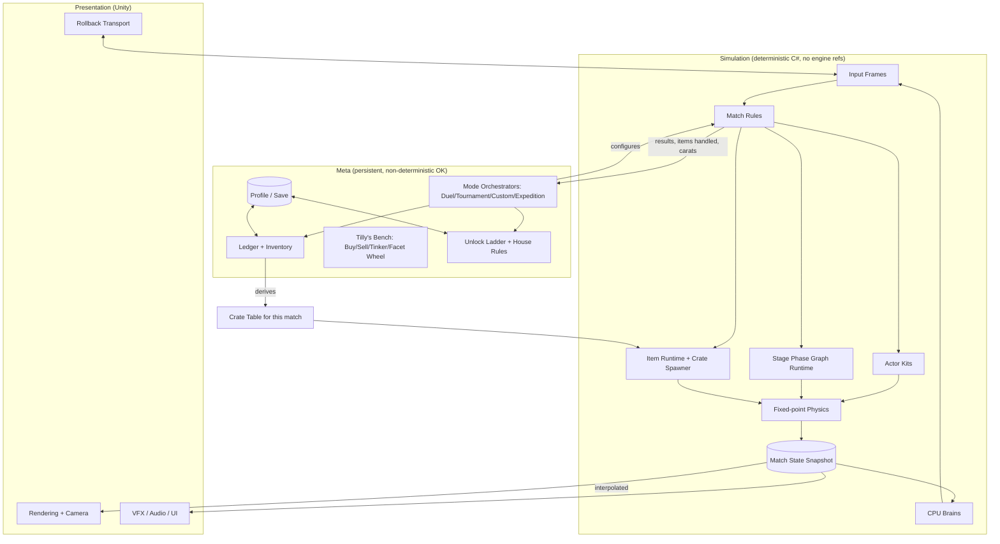

# Jewel Blitz Arena — Master Plan

Status: pre-production plan, v0.3 (theme and consistency pass; see §13 for what changed and why). The file
`Jewel Blitz Arena draft` in the repo root is the reference brief this plan was built from.
Where this plan and the brief disagree, this plan wins; the brief is kept as the record of
what the systems were modeled on.

This document is the index. Each section points at the spec that owns the detail.

| Area | Spec |
| --- | --- |
| Budgets and acceptance metrics: Life, damage, Luster, control, items, bosses, economy invariants | `docs/design/balance.md` |
| Controls, movement, dodge, combos, Blitz, KO, Squall, Basic and House Rules, assists, CPU | `docs/design/combat-and-match.md` |
| Stage phase graphs, all 11 arenas, both bosses | `docs/design/stages.md` |
| The 14 fighters and 2 bosses, Surge budget sheet | `docs/design/cast.md` |
| Proper names (fighters, forms, moves, stages, items, systems) | `docs/design/names.md` |
| Item schema, ownership gating, Tinker, shop, carat economy | `docs/design/items-and-economy.md` |
| Modes, unlock ladder, online, progression | `docs/design/modes.md` |
| Engine, deterministic sim, rollback, data pipeline, save, tools | `docs/tech/architecture.md` |
| Theme, reserved words, element accents | `docs/design/cast.md` §1, and §1 below |
| Polish and quality of life | §12 |

---

## 1. Pitch

Jewel Blitz Arena is a four-fighter 3D arena brawler. Matches are short, physical, and chaotic:
three buttons, no block, every item in the arena is shared, and the arena itself changes
shape on a timer. Collect three jewels mid-fight and you Blitz: a timed transformation
with a draining gauge that buys a special and two gauge-spending finishers.

Underneath the match is a persistent economy. Every item you have ever owned can appear in
crates in later matches. A single-player Expedition mode pays carats and writes items to your
Ledger. Tilly's Bench lets you buy, sell, and mix items in a binary crafting system with
random outcomes, a failure consolation currency, and a wheel-of-fortune carat sink. Progression
is not a stat ladder; it is widening the set of things that can spawn in the fight.

The world is the Luster Ring, realms held up by shards of the Heart Diamond. Flame, tide,
storm, stone, star, and ice are accents on fighters and stages. They are not a type chart.
House Vitre is grinding the Crown Vein into Dullglass so the Ring stops drifting. The story
stays one card per stage. Reserved words and the cast's reasons for fighting are in
`docs/design/cast.md` §1.

It is a modern successor to a turn-of-the-millennium arcade brawler, rebuilt with its own
world, cast, arenas, and item roster, with online rollback play as the headline addition.

## 2. Pillars

1. **Contention, not combos.** Depth comes from fighting over jewels and crates while the
   floor moves. Movesets are small on purpose. Mastery is positioning, item timing, and reading
   the stage clock. Measured by damage share: fighter normals 45–55%, items 20–30%, Blitz
   15–25%, stage 5–10% (`balance.md` §1).
2. **The stage is the fourth opponent.** Every story arena is a timed phase graph. Players who
   know the graph have an edge; players who do not still get a show, and a warning. At least
   80% of Tournament FFAs reach their final phase.
3. **Owning is spawning.** The crate table is derived from the player's inventory. Expedition,
   the shop, and the mixer are the progression system, not side content. Ownership changes
   *which* items spawn, never *how often* each category spawns.
4. **Readable chaos.** Four fighters, items, hazards, and a transforming arena must still be
   legible at a glance. Camera, silhouette, VFX, and audio budgets are set by this pillar. No
   effect hides a fighter's silhouette; no effect exceeds photosensitivity limits.
5. **Party first, competitive second.** Couch play with one controller joining a CPU match
   mid-run is the baseline experience. In Custom and Online, eliminated players become Wisps
   so nobody sits out. Tournament and Expedition leave Wisps off, so a revenge drop never
   decides an advance or a payout. Online is built on the same deterministic sim but never
   dictates the design of the match.

## 3. Scope at 1.0

| Category | Count | Notes |
| --- | --- | --- |
| Fighters | 14 | 12 base, 2 unlockable (Captain Citrine, Tilly Setter) |
| Bosses | 2 | The Harvester, Chairman Vitre. Not playable. |
| Story arenas | 5 | Each a timed phase graph with 2–3 phases |
| Boss arenas | 2 | Boss timers end in a stage-wide kill move |
| Extra arenas | 4 | Custom mode only, unlocked by Tournament clears |
| Usable items | 81 | 80 crate items across 8 categories, plus the Solitaire gift |
| Cosmetics | ~26 | ~25 Fitting Room items plus the Regent's Diadem |
| Materials and cards | 44 | 12 materials, 11 Tinctures, Blueprint Scrap, 20 Logbooks |
| Modes | 6 | Duel, Tournament, Custom, Expedition, Tilly's Bench (shop), Online |
| Players | 1–4 local, 2–4 online (+ CPU fill) | Shared camera; no split screen |
| Platforms | PC first (Steam, Steam Deck) | Consoles follow once the deterministic sim is proven on PC |

v0.1 listed "~120 items: ~95 usable". The roster in the items spec actually names 80 usable
items, and 80 is plenty to balance. The counts above match the roster.

Out of scope for 1.0: ranked ladders, seasonal content, user-generated stages, companion app,
cross-play (see decision D4), playable bosses.

## 4. Divergence from the reference

The brief describes the reference game's systems. The plan keeps the **systems** and replaces
the **expression**. The table below is the authoritative mapping so nobody on the team has to
re-derive what is new. Detail lives in the linked specs.

| Reference element | Jewel Blitz Arena | Where |
| --- | --- | --- |
| Transformation on three jewels | **Blitz**; the state is **Blitzed**; the gauge is **Luster** | combat |
| Basic transformed special / two gauge finishers | **Flare** / two **Surges** per fighter | combat, cast |
| Power Stone count option, default 7 | **Jewel cap**, default Auto (3 with two fighters, 5 with three or four); 3–7 by House Rule | balance, combat |
| One stone each at the start of a duel | Kept: in 2-actor matches each fighter starts with one jewel | balance |
| Extra Options | **House Rules** 1–7 across the first seven clears; later clears unlock fighters, arenas, and presets. Party staples are **Basic Rules**, always available. Sound Test is a Profile unlock, not a rule | combat, modes |
| Target Line option | Moved to **Assists**, always available | combat |
| Help countdown revive | **Rally** window, 9 s default | combat |
| Meteor sudden death | **Squall**: aimed lightning strikes that KO; same two-timer structure | combat |
| 1-on-1 / Arcade / Original / Adventure | **Duel / Tournament / Custom / Expedition** | modes |
| Arcade ladder: two FFAs, Walker, FFA, Erode | Same five-stage shape: two FFAs, Harvester, FFA, Vitre | modes |
| Item Shop (Mel's room) | **Tilly's Bench**, the lapidary shop run by Tilly Setter | items |
| Item Book / Handy Items | **Ledger** / **Pocket Items** (five flags) | items |
| Mix + Essence card; special cards; texts | **Tinker** + **Tincture**; **Blueprint Scraps**; **Logbooks**; plus **Bench Notes** | items |
| Coupons → roulette widened with carats | **Chits** → **Facet Wheel**, band widened with carats | items |
| VMU save / Mini-Book | Cloud-synced profile; Ledger is in-game; no companion app at 1.0 | tech |
| Network (JP-only web link) | Real online play with rollback; lobbies and Custom rules | tech, modes |
| Sky fortress / soul-stealing doctor | **House Vitre** has sealed the **Crown Vein**; Chairman Vitre is smelting every jewel into **Dullglass** | cast |
| Sphinx walker on desert | **The Harvester**, a walking excavator on quarry terraces, crewed by Cutters | stages, cast |
| Golem corridor + final doctor | **The Pressworks** sorting line of Vein Guard automatons, then Vitre in the Press | stages, cast |
| Blue Sky / Dark Castle / Tomb / Iceberg / Space Station | **Citrine Bazaar / Fulgur Cloister / Sunken Strongroom / Rime Cutworks / The Orrery** | stages |
| Desert / shop / city beams / water blocks extras | **Terraces / Behind the Counter / Spirewalk / The Cascade** | stages |
| Returning + new cast of 14 | Entirely new cast of 14 covering the same archetype spread | cast |
| Father unlock at 7 clears, shopkeeper at 8 | **Captain Citrine** (Rook's grandmother) at 7, **Tilly Setter** at 8 | modes |
| Light Jewel / Emperor's Crown gifts | **Solitaire** / **Regent's Diadem** (the 100,000 sale) | items |
| Dreamcast A/B/X/Y mapping | Same four-face-button layout on modern pads; positions preserved; Surges default to shoulders | combat |
| Pause + X+Y expanded pause | Pause → **Photo Mode** | modes |

Mechanics carried over without rename because they are generic verbs: no block,
directional-tap dodge, pickup ring, timed catch, wall spring, pillar grab (ground rebound /
air hang), throw on Attack+Strong, four-actor cap, top-two advancement, boss cooperation,
drop-in second controller, losing all stones on a fall.

## 5. Platform and technology decisions

Each decision is recorded with its rationale so it can be reopened deliberately. Full detail in
`docs/tech/architecture.md`.

- **D1 — Engine: Unity 6, C#, with the entire match simulation in an engine-agnostic C#
  assembly.** The sim assembly has no `UnityEngine` references. The engine is presentation,
  input, audio, platform, and tooling. Godot 4 (C#) is the recorded fallback; the sim
  assembly ports as-is. Caveat: Godot console exports go through third-party porting
  partners, so choosing the fallback moves console risk rather than removing it.
- **D2 — Deterministic fixed-point simulation.** 60 Hz fixed step, **Q48.16** fixed-point
  math (the format Photon Quantum ships), integer Life, Luster, and timers. A custom
  collision and rigid-body solver for spheres, capsules, boxes, and convex hulls. Thrown
  items, jewels, debris that affects play, kinematic stage pieces, and CPU brains all live
  in the sim. Cloth, particles, ragdoll-on-death, and cosmetic debris live in presentation
  only. v0.1 chose Q32.32, whose multiplies need 128-bit math that Unity's .NET profile
  lacks.
- **D3 — Rollback netcode from the vertical slice onward.** GGPO-style, 2–4 peers, input
  delay 2 frames (negotiated 0–4), rollback window 8 frames, quantized inputs (2 bytes per
  player per frame). Rollback is cheap only if the sim is cheap to snapshot; this constrains
  sim data layout from day one (one blittable struct, no managed allocations per frame).
  Transport is Steam Datagram Relay on PC.
- **D4 — No cross-play at 1.0.** Determinism is proven per platform build. Cross-play is a
  post-launch decision gated on a cross-platform determinism CI harness passing for one full
  content cycle.
- **D5 — Data-driven content.** Fighters, items, crate tables, stage phase graphs, House
  Rules, prices, and unlock conditions are data (ScriptableObjects authored in editor,
  exported to a versioned binary blob for runtime). Designers do not need a programmer to
  add an item or a stage phase. Every export is validated against the `balance.md` budgets.
- **D6 — Shared camera, no split screen.** One dynamic camera frames up to four actors in a
  3D volume, with edge bubbles for anyone it cannot fit. This is a core system with its own
  owner, not a utility.
- **D7 — PC first (Steam, Steam Deck).** Console ports begin after the M2 determinism gate.
  The sim is a fixed 60 Hz on all platforms; rendering runs at native refresh with
  interpolation, and a Low Latency option renders at 60 Hz without it. 60 fps is the floor
  at minimum spec.

## 6. Architecture overview

The boundary that matters: **the sim never reads the profile directly.** A mode orchestrator
builds a `MatchConfig` (fighters, stage, Basic and House Rules, crate table, CPU levels, seed)
and hands it to the sim. The sim returns a `MatchResult` (placements, KOs, items handled,
gleam pickups collected). This keeps the sim replayable from a config plus input log, which
is what rollback, replays, determinism CI, and balance simulation all depend on.

## 7. Systems and owners

| System | Scope | Primary spec |
| --- | --- | --- |
| Balance budgets | Life, damage, Luster, control, item bands, boss kill times, metrics | balance |
| Match rules | Life, jewels, Blitz, Luster drain, Rally, Squall, draw, placements, Wisps | combat |
| Actor kit | movement, dodge, 3-button attack strings, chains, getup, throw and break, wall spring, pillar grab, item use, Flare, Surges | combat, cast |
| Fixed-point physics | shapes, solver, kinematic platforms, triggers, pickup rings | tech |
| Stage phase graph runtime | timers, transitions, player-count variants, hazards, gimmick boarding, stage-only weapons | stages |
| Item runtime | pickup/throw/catch, held vs placed vs consumed, summons, status effects, durations | items |
| Crate spawner | two-stage category/item roll from ownership + always-eligible set + stage overrides | items |
| Camera | 4-actor framing in a volume, edge bubbles, phase transitions, boss framing | tech |
| Boss AI | Harvester and Vitre state machines, breakable parts, timeout kill move | stages, cast |
| CPU fighters | difficulty 1–8 in the sim, item preference, jewel greed, team awareness, fairness rules | combat, tech |
| Mode orchestrators | ladder, two-left advancement, drop-in, boss cooperation, Expedition rewards | modes |
| Economy | inventory, slot capacity, Pocket Items, Tinker, Facet Wheel, prices, gleam pickups | items |
| Unlocks | per-clear House Rules, fighter unlocks, extra arenas, presets, palettes, gifts | modes |
| Save / profile | cloud sync, versioned schema, migration | tech |
| Netcode | rollback, lobbies, Custom rules negotiation, disconnect-to-CPU, desync detection | tech |
| UI | front end, HUD (horizontal status bars, Luster gauge), Ledger, Fitting Room, onboarding prompts | tech, modes |
| Accessibility | remap, assists, colorblind palettes, reduced motion, photosensitivity | combat, tech |
| Tools | stage graph editor, item/crate editor, balance sheet, economy simulator, replay viewer, determinism CI, flash analysis | tech |

## 8. Production roadmap

No calendar estimates. Each milestone is defined by what must exist and what must be proven.
A milestone is not done until its exit criteria hold on a clean build from `main`.

### M0 — Pre-production (this plan)

Build: greybox prototype. One flat arena, two fighters with placeholder kits, jewels with
the circulation cap, Blitz with one Flare and one Surge, items as pickup/throw/catch,
dodge with flick detection, KO. Local only.

Exit criteria:
- Fixed-point sim assembly runs headless; the same input log produces an identical state hash
  on two machines.
- A 4-actor match step, including CPU brains, costs ≤ 0.35 ms on the target minimum PC spec,
  so that nine steps per frame (one new, eight rollback) fit in 4 ms.
- Engine decision D1 confirmed or reopened with evidence.
- `balance.md` budgets and the cast, stage, and item documents signed off at the level in
  this plan.

### M1 — Vertical slice

Build: Citrine Bazaar with its full three-phase graph. Four fighters (Rook, Sable, Bulwark Oyo,
Clank) with complete kits. Twenty items across every functional category. Full match rules:
chains and getup, throws and throw break, status immunities, Rally, Squall, draw,
placements, Wisps. Rematch, team shapes, and the Sparring preset. Shared camera with edge
bubbles. HUD. Two-player rollback over LAN.
Accessibility foundations: full remap, Dodge Assist, Target Line, colorblind palettes. Steam
Remote Play Together verified.

Exit criteria:
- A stranger can play a four-player Custom match on one stage and read what is happening. In
  playtests, at least 80% of first-time players can explain how to Blitz after one match.
- Phase graph is authored entirely in the stage editor, no code.
- Rollback at 8 frames shows no visible pops in the vertical slice stage.
- Camera never loses an actor for more than 10 frames outside scripted transitions (edge
  bubbles count as on screen).
- Jewel cap A/B playtest (5 vs 7 at four players) run and open decision 7 closed.
- Balance sheet export shows every slice move inside its `balance.md` budget.

### M2 — Systems alpha

Build: every mode in skeleton form. Item system fully data-driven with ownership-gated crate
table. Tilly's Bench with buy, sell, Tinker (with Bench Notes and the tier preview), Facet
Wheel, Ledger filters, and hold-to-confirm on expensive sells. Expedition loop
with gleam pickups, chests, Ledger writes, and clear bonus. Profile save with migration. Eight
fighters. Three story stages. The Harvester playable end-to-end. CPU difficulty 1–8 scaffold
inside the sim.

Exit criteria:
- Economy simulator reproduces the carat-per-difficulty table in `items-and-economy.md` §7
  within 15%, and every invariant in `balance.md` §10 holds (no arbitrage loop, carats per
  minute monotonic).
- Crate table tests pass: owned items appear, unowned do not, `never` items appear only as
  pocketed `pocketable` items, and category share stays stable as the table grows.
- Harvester kill times for one and two fighters fall inside the `balance.md` §8 table.
- **Determinism gate:** CI runs 1,000 recorded matches on the .NET runner and on IL2CPP
  players, on Windows and Linux, and all hashes match. Console port work may begin after this
  gate passes.

### M3 — Content alpha

Build: all 14 fighters, all 11 arenas, both bosses, all items, House Rules fully unlockable,
extra arenas reachable via the stage list overflow, four-player rollback online with lobbies,
CPU fill, and disconnect-to-CPU. Pause-only phase timeline. Fall-edge marker on `fall_is_ko`
stages.

Exit criteria:
- Every unlock in `docs/design/modes.md` is reachable and automated tests assert each
  condition.
- Every fighter has Flare and two Surges with final-timing hitboxes, inside the cast
  spec's budget sheet.
- Online four-player match at 60 ms RTT with 10 ms jitter and 1% loss: mean rollback depth
  ≤ 1 frame, 99th percentile ≤ 4 frames, no more than one stall longer than 3 frames per
  minute, and zero desyncs across the soak corpus. (v0.1's "under 3% of frames rolled back"
  measured the wrong thing. With 2 frames of delay and real jitter, most rollbacks are one
  frame deep and invisible; depth and stalls are what players feel.)
- Flash analysis passes on every Surge, Squall, and boss attack.

### M4 — Beta

Build: balance pass on fighters, items, prices, Expedition rewards. Remaining accessibility
(reduced motion, HUD scale, audio cues and captions). Localization. Steam Deck Verified
submission. Platform certification for the first console target. Photo Mode. Full results
breakdown and Watch Replay on local results. Sparring hitbox view and item spawner.

Exit criteria:
- Every acceptance metric in `balance.md` §9 holds in human playtests: 1v1 matchups 40–60%,
  per-fighter 1v1 45–55%, 4-actor FFA win share 20–30%, item usage 0.3×–2× its category
  median, Blitz conversion 35–55%, and damage share by source in band. (v0.1 required
  45–55% win rates for every fighter. In a four-player FFA the fair win rate is 25%, so that
  criterion could never pass.)
- Match-length targets in `balance.md` §1 hold, including ≥ 80% of Tournament FFAs reaching
  the final phase.
- Save migration tested from every alpha schema version.

### M5 — Release candidate

Build: content lock, crash rate and desync rate below targets, day-one patch plan, telemetry
for every `balance.md` §9 metric, crate spawns, item usage, Tinker outcomes, and Facet Wheel
spend.

## 9. Team shape

Roles, not headcount. Several can be the same person early.

- Combat/sim engineer (owns the sim assembly and physics)
- Netcode engineer (rollback, lobbies, desync tooling)
- Gameplay engineer, stages (phase graph runtime, bosses, hazards)
- Gameplay engineer, meta (items, economy, modes, save)
- Gameplay engineer, AI (CPU brains in the sim, boss AI support)
- Tools engineer (editors, economy simulator, determinism CI)
- Camera/presentation engineer
- Combat designer (kits, Surges, item balance; owns `balance.md` with the economy designer)
- Stage designer ×2 (phase graphs, extra arenas, boss encounters)
- Economy designer (prices, rarity, Tinker tables, Expedition rewards)
- Character art (14 fighters × base + Blitzed form, 2 bosses, cosmetics)
- Environment art (11 arenas with phase variants)
- VFX, animation, audio, UI as separate disciplines once past M1
- Producer / QA lead, with an accessibility and photosensitivity checklist owner

## 10. Risks

| Risk | Impact | Mitigation |
| --- | --- | --- |
| Deterministic physics for a "physics-heavy" brawler is a custom solver with custom bugs | Schedule and feel | Keep sim shapes primitive; put all cosmetic physics in presentation; determinism CI from M0 |
| IL2CPP or runtime differences break determinism that the test runner never sees | Desyncs in shipped builds | Determinism corpus runs on the shipping IL2CPP player nightly; analyzer bans unstable sorts, hash-order iteration, and floats in `Sim` |
| Rollback with 4 peers and a stage phase graph that spawns many objects | Snapshot and re-step cost | One blittable state struct, fixed pool caps per stage, 0.35 ms step budget from M0, sim on its own thread |
| Camera legibility with 4 actors across a vertically layered arena | Pillar 4 | Camera is a first-class system; stage designers author camera volumes per phase; edge bubbles |
| Four-player gang-ups and chained stuns make matches feel unfair | Party feel | Target-side chain ceiling, getup invulnerability, status immunities, CPU anti-dogpile rule |
| Blitz snowballs: the leader keeps Blitzing | Contention pillar | Circulation cap, jewel loss on knockdown and fall, Dross cooldown, respawn far from the reverted fighter |
| Ownership-gated crate table makes new players' matches sparse, or veterans' matches diluted | Early and late game feel | 25-item starter set; two-stage category roll keeps the category mix identical at any table size |
| Tinker randomness reads as unfair | Economy trust | Chits on every failure, visible wheel odds, input-seeded rolls, Bench Notes remember every outcome, Logbooks reveal pools |
| An economy loop prints carats | Economy collapse | No-arbitrage invariant checked by the simulator on every content export |
| Loot-box regulation | Legal, ratings | Monetization firewall: carats, Chits, Tinker, and the Facet Wheel are never sold for real money |
| Photosensitive seizure risk from lightning, electric, and flash VFX | Player safety, certification | Three-flash rule designed in from M1; automated flash analysis from M3 |
| CPU-vs-CPU sweeps mistaken for balance data | Wrong balance calls | Sweeps are regression-only; sign-off uses human playtest metrics (`balance.md` §9) |
| Title or character names collide with existing marks | Marketing, legal | Trademark clearance on the title, House Vitre, and the cast (including Citrine, Vitre, and Tilly Setter) before M3 marketing beats |
| Content volume (14 kits × 2 forms, 11 arenas, 81 items) | Scope | Fitting Room cosmetics are attachment-only; extra arenas reuse story kits of props; M3 is the content gate, not M4 |
| Platform cert for online 4-player | Release | Console ports start only after the M2 determinism gate |

## 11. Open decisions

Tracked here until resolved; each has a default so work can proceed.

1. **Luster drain while standing still vs. while acting.** Default: constant drain of 1 per
   frame, Surges spend 420, Flare spends none. Reopen after M1 playtests.
2. **Jewel loss on knockdown.** Default: a knockdown drops one held jewel, and a fall-out
   drops all of them. Blitz is instant on the third, so a fighter only holds three while
   a phase is `blitz_suppressed`, and the same rule applies then.
3. **Rally in free-for-all.** Default: Rally only exists when teams are on (boss arenas,
   Custom teams). In pure FFA, KO is final. Wisps cover eliminated humans in Custom and Online only.
4. **Extra arena unlock counts.** Resolved in v0.2: a plain distinct-clear ladder (9, 11, 13,
   14) with a reward at every count from 1 to 14. See modes spec §8.
5. **Online Custom with Pocket Items.** Default: host's Pocket Items are eligible; guests' are
   not. Everyone sees the table before ready-up.
6. **Expedition difficulty 1–8 vs. a continuous slider.** Default: eight discrete levels
   because opponent count per stage is tied to the level.
7. **Jewel cap default at four players: 5 or the reference's 7.** Default 5: one Blitzed
   fighter at a time, which makes the jewel race the match's focus and keeps it readable.
   At 7, two fighters can be Blitzed at once and jewels are rarely scarce. Close with an
   A/B playtest at M1.
8. **Tournament FFA ends at two remaining.** Default: yes, because both advance anyway and
   it keeps stage length in band. Reopen if playtests show FFAs feel anticlimactic; the
   alternative is last-standing with the last-KO'd fighter advancing second.
9. **Wisps default.** Resolved for Tournament, Expedition, Duel, and bosses: off. Default
   remains on in Custom and Online. Reopen that default if playtests show Wisp drops deciding
   close matches. The 1-Life floor is the first lever.

## 12. Polish and quality of life

These are in the 1.0 plan. They are listed on the milestone build lines above and are not
new exit criteria. Each one removes a confusion the systems would otherwise ship with.
Detail lives in the owning spec.

| Addition | Where | Milestone |
| --- | --- | --- |
| Rematch on Duel, Custom, and Online results (same config, new seed) | modes §10 | M1 |
| Team shape beside player color; Life bars group by team | combat §13 | M1 |
| Per-slot CPU level in Custom and Online | combat §10.1 | M1 |
| Sparring preset: Terraces geometry, local only, from the first boot | modes §4 | M1 stub, M4 hitboxes and item spawner |
| Results card: placement, KOs, jewels, Blitz count, one-line damage split | modes §10 | M1, full split at M4 |
| Lobby stamp when a Basic or House Rule is not the default | modes §4 | M2 |
| Ledger filters, bulk sell, hold-to-confirm above 10,000 carats | items §3 | M2 |
| Tinker shows affinity tags and target tier before the roll, not the pool | items §4 | M2 |
| Shop stock marks items never owned | items §6 | M2 |
| Pause-only phase timeline | combat §2 | M3 |
| Fall-edge lip and tone on `fall_is_ko` stages | combat §3 | M3 |
| Watch Replay on local results | modes §10 | M4 |

Still out of 1.0, on purpose: ranked play, cross-play, a stage editor, an elemental advantage
chart, and a second tutorial mode beside Sparring and Duel.

## 13. Revision log

### v0.2 — review pass

Errors fixed:
- **Rollback performance math.** The step budget is now 0.35 ms. At v0.1's 2 ms, nine steps
  per frame cost 18 ms, more than a whole 60 Hz frame (`architecture.md` §10).
- **Fixed-point format.** Changed from Q32.32 to Q48.16 (D2).
- **Tournament shape.** "Three FFAs and two bosses, six stages" was arithmetically wrong in
  both the brief and v0.1. It is now the reference's actual five-stage shape.
- **Squall.** It was "1000 damage (one-shot)", which neither one-shots 1150-Life fighters
  nor survives the 50% Blitzed damage scaling. It is now a true KO.
- **Rally.** The Rally window was 9 s while the body despawned after 1 s. The body now
  persists for the whole window.
- **Monastery gong.** It reversed gravity in an open-air courtyard; it now lowers gravity.
  The 4 s Landslide "phase" broke the 20 s phase minimum and is now a transition.
- **Phase timing.** Phases ran past typical match length, so final phases were rarely seen.
  Every final phase now starts by 55 s.
- **Expedition boss.** A solo Marrow at difficulty 8 was impossible within the timeout.
  Boss Life now scales by participant count, and Expedition gives the player a CPU ally.
- **Harvester.** The tail route cost half the damage of the head route with no extra risk.
  Leg repair and Buck now balance the two.
- **Life.** "0–1000 for everyone" contradicted the per-fighter Life ratings; Life is now an
  integer per fighter.
- **Luster drain.** 0.83 per frame was a fractional drain; Luster is now 0–1200, drained 1
  per frame.
- **Tilly's Invoice.** It contradicted the "same Luster for variants" rule and had no
  damage cap. It now uses a declared per-move cost held to the shared damage-per-Luster ratio.
- **Name collisions.** Squall line, Tide Wheel ×3, Salvage, and Anchor ×3 each named two or
  more different things; all are renamed.
- **Unlock conditions.** "12 distinct clears (all base fighters)" stated two different
  conditions as one.
- **Prices and counts.** The Flamethrower and Repeater sell prices were outside the
  stated band. The item counts did not match the roster.
- **Win-rate criterion.** "45–55% win rate" was impossible in four-player FFA, where the
  fair rate is 25%.
- **Tinker.** It used banker's-rounding-prone `round()`, and its seed let players learn a
  failure in advance and feed it junk. Blueprint Scraps did not actually gate tier 7.

Systems added:
- `balance.md`: damage, Luster, control, item, and boss budgets, plus acceptance metrics.
- Dodge flick, lockout, and cooldown rules.
- Target-side combo ceiling.
- Getup and `otg` rules.
- Throw break and the attack/throw/dodge triangle.
- Status classes with immunities.
- Jewel circulation cap and anti-snowball rules.
- Basic Rules (handicap, item switch, Gulls) and Assists.
- Edge bubbles.
- CPU fairness rules and CPU brains in the sim.
- Two-stage crate roll and a named 25-item starter set.
- Bench Notes.
- Budgeted gold drops with a per-difficulty curve.
- Monetization firewall.
- Online disconnect-to-CPU and Steam Datagram Relay.
- Determinism hazard bans and IL2CPP determinism CI.
- Input quantization.
- Photosensitivity rule.
- First-run onboarding prompts.
- A reward at every distinct clear.

### v0.3 — theme and consistency pass

The word "coconut" was already gone. The setting was not. v0.2 still described a sky-sea of
islands, a dock shop, shell money, seagulls, lagoons, and a whale. That was the old theme
with the nouns scraped off. v0.3 puts jewels at the center and keeps the elemental range of
the reference: flame, tide, storm, stone, star, and ice, as accents rather than a type chart.

Setting and names:
- World is the Luster Ring around the Heart Diamond. House Vitre smelts the Crown Vein into
  Dullglass. Chairman Vitre replaces Marrow. Captain Citrine and Rook Citrine replace the
  Marigolds. Tilly Setter runs Tilly's Bench.
- Story arenas: Citrine Bazaar, Fulgur Cloister, Sunken Strongroom, Rime Cutworks, the
  Orrery. Extras: Terraces, Behind the Counter, Spirewalk, The Cascade.
- Currency is carats, paid by gleam pickups. Failed Tinker pays Scrap (material) and a Chit
  (token). The shop wheel is the Facet Wheel. Eliminated humans in Custom and Online are
  Wisps. Reserved words are in `cast.md` §1.2.
- Canonical tags are flame, tide, storm, stone, star, ice, powder, metal, glass, paper, and
  food. Each has one material and one Tincture. The Gold material is gone, because it
  collided with the currency. Ration fills the food tag, which previously had none.

Balance and consistency, numbers only where a budget was already broken:
- Clank's mortar 260 → 280. His mine field is a utility variant at 70, one mine per actor
  per cast, so a trap is not retuned into a second damage Surge. Repair heal 250 → 280.
  Hob's pool 240 → 200. All four were outside `balance.md`.
- Displacement and ranged Strongs are tagged exemptions. Delphine deals 0. Ferro's shot
  stays 60. Hob's pan deals 80 and still reflects.
- Heals are priced as single-target Surges, not as the 80-damage utility cap.
- Wisps are off in Tournament, Expedition, Duel, and bosses. The pillar used to say they
  were universal, and the combat spec said they were off only on bosses and in Expedition.
- Sound Test is a Profile unlock at eight clears, not House Rule 8.
- Fulgur Cloister's floor split happens 12 s into the library, not 25 s, so matches see it.
- The Orrery beetle drops one bonus jewel at half Life and one on kill.
- A boss has one in-fight instant KO. The timeout is separate. Harvester kill time includes
  the leg gate. It is not route damage divided by the blended rate.
- Blitz conversion means "advanced" when the match ends at two left, and "first" when it
  ends at last standing.
- Damage share is measured on Custom defaults, Wisps on.
- Materials and cards are not a crate bias. They drop on an Expedition container stream.
  Citrine Bazaar weights Flame, Ice, Iron, and Gunpowder there. Scraps and Tinctures drop
  only in the Pressworks. The old "crate bias" could not have worked: those items are
  `never` eligible for crates.

Polish in §12. No new mode, no elemental rock-paper-scissors, no ranked play.
